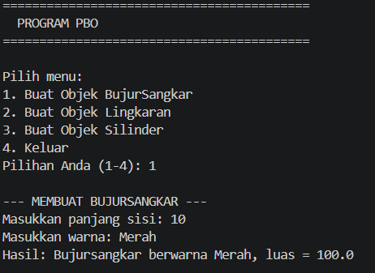
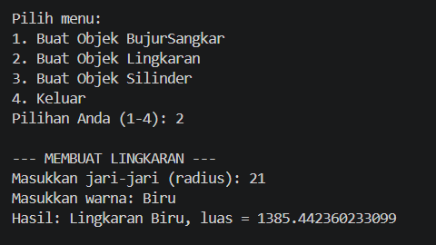
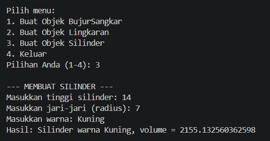
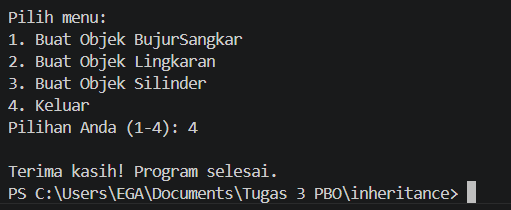

# Latihan/Eksplorasi Materi Inheritance, Encapsulation, dan Polymorphism

Repositori ini berisi implementasi program Java berbasis Pemrograman Berorientasi Objek (PBO) yang mengeksplorasi konsep **Encapsulation**, **Inheritance**, dan **Polymorphism** menggunakan hierarki kelas bentuk geometri (Bentuk, BujurSangkar, Lingkaran, dan Silinder).

---

## 📌 Konsep PBO yang Diterapkan

### 1. Encapsulation (Pengkapsulan)
Encapsulation digunakan untuk melindungi data/atribut kelas agar tidak bisa diakses secara langsung dari luar kelas, melainkan melalui metode akses (*getter* dan *setter*).
* **Atribut Private:** Variabel seperti `private double sisi` pada `BujurSangkar`, `private double radius` pada `Lingkaran`, serta `private double tinggi` pada `Silinder` dideklarasikan secara `private`.
* **Getter dan Setter:** Disediakan metode seperti `getSisi()`, `setSisi()`, `getRadius()`, dan `setTinggi()` untuk mengelola data secara aman.

### 2. Inheritance (Pewarisan)
Inheritance memungkinkan suatu kelas (*subclass*) mewarisi properti dan metode dari kelas lain (*superclass*).
* **`BujurSangkar`** meng-extends **`Bentuk`**: Mewarisi atribut `warna` dan metode terkait dari `Bentuk`.
* **`Lingkaran`** meng-extends **`Bentuk`**: Mewarisi atribut `warna` dari `Bentuk`.
* **`Silinder`** meng-extends **`Lingkaran`**: Mewarisi atribut `radius` serta metode `hitungLuas()` dari `Lingkaran` untuk menghitung volume (`hitungLuas() * tinggi`).
* Penggunaan kata kunci `super()` pada konstruktor *subclass* memanggil konstruktor dari *superclass*.

### 3. Polymorphism (Polimorfisme)
Polymorphism diimplementasikan melalui **Method Overriding**, di mana *subclass* memberikan implementasi spesifik dari metode yang sudah ada di *superclass*.
* Metode `printInfo()` didefinisikan awal pada kelas `Bentuk`.
* Kelas `BujurSangkar`, `Lingkaran`, dan `Silinder` melakukan `@Override` pada metode `printInfo()` untuk menampilkan informasi spesifik sesuai jenis bangun/bentuknya.

---

## 🗂️ Struktur File
* `Bentuk.java` - Superclass utama yang menyimpan atribut `warna`.
* `BujurSangkar.java` - Subclass dari `Bentuk` untuk mengolah bangun bujursangkar.
* `Lingkaran.java` - Subclass dari `Bentuk` untuk mengolah bangun lingkaran.
* `Silinder.java` - Subclass dari `Lingkaran` untuk mengolah bangun ruang silinder.
* `Main.java` - Kelas utama yang berisi menu interaktif (menggunakan `Scanner`) untuk menjalankan eksplorasi program.

---

## 📸 Screenshot Output Program

> *Tambahkan screenshot hasil eksekusi program di bawah ini:*

